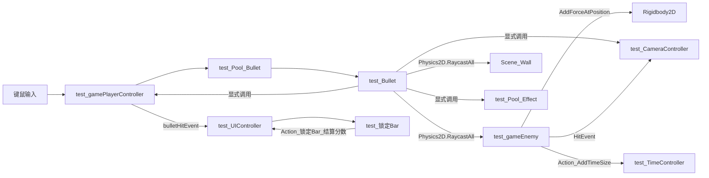

# BoomShooting 架构与系统配合说明

> 项目定位：Unity + URP 2D 俯视角弹幕射击原型。
> 开发周期：约 2.5 天，策划、程序、美术资源均为快速完成。
> 核心研究目标：打击感设计，以及特效对象的批量生成与池化管理。
> 本文档按当前可运行版本的实际实现编写，并尽量标注对应的类、方法、字段和代码路径。

---

## 1. 项目定位与核心玩法

BoomShooting 是一个单场景的封闭空间射击原型。玩家控制白色方块，在地图内移动并射击深灰色目标；目标会通过速度转向不断靠近玩家。玩家命中目标后，一方面获得即时命中分，另一方面建立锁定并累积连击奖励。锁定倒计时结束后，连击奖励结算进总分。

核心循环：

```text
移动走位
  -> 鼠标瞄准
  -> 左键射击
  -> 子弹命中目标
  -> 物理击退 + 特效 + 相机震动 + 慢动作
  -> 首次有效命中建立锁定
  -> 重复命中锁定目标，刷新倒计时并累积倍率
  -> 倒计时结束结算锁定奖励
  -> 存活到 60 秒结束
```

游戏结束条件：

- 倒计时归零。
- 敌人与玩家发生物理碰撞。

结束后的计分入口会在 `test_UIController` 中通过 `game_time <= 0f` 提前返回，但玩家仍可继续移动、射击和使用快捷指令，方便测试和展示。

---

## 2. 系统协作总览

| 环节 | 入口类 / 方法 | 主要作用 |
|---|---|---|
| 读取输入 | `test_gamePlayerController.Update()` | 读取 WASD 与鼠标左键、滚轮 |
| 玩家移动 | `test_gamePlayerController.FixedUpdate()` | 计算并写入 `Rigidbody2D.velocity` |
| 射击 | `test_gamePlayerController.Shoot()` | 从对象池取子弹并初始化 |
| 子弹池 | `test_Pool_Bullet.GetBlockObject()` | 返回未激活子弹，必要时扩容 |
| 子弹推进 | `test_Bullet.Update()` | 每帧计算下一位置并执行 `Physics2D.RaycastAll` |
| 命中敌人 | `test_gameEnemy.Hit()` | 施加物理冲量、触发相机震动、触发慢动作 |
| 命中墙 | `test_Bullet.Update()` 中的墙体分支 | 停住子弹、播放撞墙反馈、通知未命中 |
| 目标追踪 | `test_gameEnemy.Action_Move()` | 根据当前速度给刚体增加指向玩家的冲量 |
| 打击反馈 | `test_Bullet.Update()` 中的显式调用链 | 依次调用特效池、相机控制器、时间控制器和 UI |
| 锁定与连击 | `test_锁定Bar.Hit()` | 记录目标、命中次数、倍率和待结算分 |
| 锁定倒计时 | `test_锁定Bar.Update锁定()` | 推进倒计时并在归零时结算 |
| 总分显示 | `test_UIController.Action_锁定Bar_BulletHit()` / `Action_锁定Bar_结算分数()` | 即时命中加分与锁定奖励入账 |
| 计时与结束 | `test_UIController.Update()` / `Action_GamePlayerHit()` | 60 秒倒计时、碰撞结束、提示文本 |
| 相机震动 | `test_CameraController.Action_CameraShake_BulletHit()` | 切换震动虚拟相机并播放曲线 |
| 慢动作 | `test_TimeController.Action_AddTimeSize()` | 短暂降低 `Time.timeScale` 后恢复 |
| 特效池 | `test_Pool_Effect.GetEffectObject()` / `UpdateEffect()` | 按名称复用特效并统一推进生命周期 |
| 玩家自定义与调试 | `test_UIController.Update()`、`test_gameEnemy.Update()` | 指令栏、参数切换、敌人复制/缩放等 |

系统调用关系：



---

## 3. 技术栈与启动入口

| 项目 | 当前使用 |
|---|---|
| Unity | 2021.3.45f2c1 |
| 渲染 | URP 12.1.15 |
| 物理 | Physics2D |
| 相机 | Cinemachine 2.10.3 |
| UI | UGUI + Legacy Text |
| 输入 | 旧版 `Input` / `InputManager` |
| 主场景 | `Assets/Scenes/SampleScene.unity` |
| 程序集 | 未使用 asmdef，脚本进入 `Assembly-CSharp` |

启动时的主要初始化：

| 初始化内容 | 代码位置 |
|---|---|
| 玩家相机缓存、刚体缓存 | `test_gamePlayerController.Start()` |
| 分数清零、60 秒倒计时 | `test_UIController.Start()` |
| 子弹池预生成 20 发 | `test_Pool_Bullet.Start()` |
| 特效池预生成并启动统一更新协程 | `test_Pool_Effect.Start()` |
| 相机震动字典初始化 | `test_CameraController.Awake()` / `Init()` |
| 时间倍率归 1 | `test_TimeController.Start()` |

---

## 4. 场景与世界配置

### 4.1 主要场景层级

```text
SampleScene
├─ -----游戏-----
│  ├─ gamePlayer_Root
│  │  ├─ gamePlayer_视觉
│  │  │  ├─ body
│  │  │  ├─ Shoot
│  │  │  ├─ 移动指向
│  │  │  └─ 玩家指示线_*
│  │  └─ gamePlayer_碰撞
│  ├─ gameEnemy_Root
│  │  ├─ gameEnemy_视觉
│  │  └─ 移动指向
│  └─ Square (1) / Particle System
├─ -----场景-----
│  ├─ Global Volume
│  ├─ Global Light 2D
│  ├─ 墙
│  └─ 粒子效果
├─ -----相机-----
│  ├─ 相机跟随目标
│  ├─ 默认状态/cm
│  ├─ 震动状态/cm
│  └─ Main Camera
├─ -----UI-----
│  ├─ EventSystem
│  └─ Canvas
│     ├─ Bar
│     ├─ gamePlayer/准星
│     └─ Data
└─ -----系统-----
   ├─ BulletPool
   ├─ EffectPool
   └─ GameTimeController
```

### 4.2 地图与物理配置

- 墙体由 4 个父对象和子 `BoxCollider2D` 构成。
- 当前内边界约为 `x = -22 ~ 22`、`y = -12 ~ 12`。
- 主相机为正交相机，`orthographic size = 15`。
- 玩家初始位置为 `(0, 0)`。
- 敌人初始位置为 `(0, -10)`，初始缩放为 `5`。
- 敌人刚体：`mass = 1`、`gravityScale = 0`、`linearDrag = 0`。
- 玩家刚体：`gravityScale = 0`、旋转冻结。
- 碰撞层：`Scene_Wall = 8`、`Game_Player = 9`、`Game_Enemy = 10`。
- 自定义 Tag：`Player`、`Enemy`。

---

## 5. 玩家输入、移动与射击

### 5.1 输入读取

对应方法：`test_gamePlayerController.Update()`。

```csharp
_Input_move = new Vector2(
    Input.GetAxisRaw("Horizontal"),
    Input.GetAxisRaw("Vertical")
);

_Input_ShootDown = Input.GetMouseButton(0);
```

鼠标滚轮用于切换 `射速预设`，相关字段：

```csharp
public List<float> 射速预设 = new List<float>();
public int Index射速 = -1;
```

### 5.2 移动计算

对应方法：`test_gamePlayerController.FixedUpdate()`。

有输入的轴：

```text
speedNext = speedCur + input * move_Accelerate
```

无输入的轴：

```text
speedNext = Lerp(speedCur, 0, idleResistance)
```

最终写入：

```csharp
_Value_NextSpeed_All = _Value_NextSpeed_Move;
rb2D.velocity = _Value_NextSpeed_All;
```

移动参数来自 `test_gamePlayer_Data`：

| 字段 | 当前值 |
|---|---:|
| `move_MaxSpeed` | 20 |
| `move_Accelerate` | 2.5 |
| `idle_Resistance` | 1 |
| `obj_DirObj_MaxSize` | 5 |

玩家视觉朝向对应 `Update_PlayerDir()`：

```csharp
Obj_gamePlayer_BodyObj.transform.up =
    _camera.ScreenToWorldPoint(Input.mousePosition) - transform.position;
```

速度方向指示对应 `Update_DirObj()`。

### 5.3 射击

对应方法：`test_gamePlayerController.Shoot()`。

```csharp
test_Bullet bullet = test_Pool_Bullet.instance.GetBlockObject();

if (bullet != null)
{
    bullet.Init(
        Obj_gamePlayer_ShootObj.transform.position,
        _camera.ScreenToWorldPoint(Input.mousePosition) - transform.position,
        data.shoot_BulletSpeed,
        data.shoot_ButtleMass
    );
}
```

射击参数：

| 字段 | 当前值 |
|---|---:|
| `shoot_BulletSpeed` | 500 |
| `shoot_ButtleMass` | 0.05 |
| `shoot_IntervalTime` | 0.4 |
| 射速预设 | 0.4 / 0.2 / 0.1 / 0.05 / 0.02 |

---
## 6. 目标运动、受击与物理数据

### 6.1 目标追踪

对应类：`test_gameEnemy`。
对应方法：`Action_Move()`，由 `FixedUpdate()` 调用。

实际代码：

```csharp
private void Action_Move()
{
    if (!test_UIController.instance.test_敌人跟踪开关) return;

    var nextDir = test_gamePlayerController.instance._Value_CurPosition
                - _Value_CurPosition;

    rb2D.AddForce(
        nextDir.normalized * Mathf.Min((_Value_CurSpeed.magnitude * 0.05f), 50f),
        ForceMode2D.Impulse
    );
}
```

这段逻辑不是持续施加一个固定指向玩家的推力，而是：

```text
d = normalize(playerPosition - enemyPosition)
impulseMagnitude = min(|v| * 0.05, 50)
v_next = v + d * impulseMagnitude / enemyMass
```

当前敌人 `mass = 1`，因此可近似写成：

```text
v_next = v + d * min(|v| * 0.05, 50)
```

由此得到以下行为：

- 当目标速度为 0 时，冲量大小也为 0，目标不会移动。
- 速度越大，指向玩家的速度增量越大。
- 该增量不断叠加到当前速度上，使目标速度方向逐渐偏向玩家当前位置。
- 因此目标是速度驱动的转向/追踪，而不是恒定追踪推力。

当 `test_敌人钉死开关` 开启时，`test_gameEnemy.FixedUpdate()` 会直接执行：

```csharp
rb2D.velocity = Vector2.zero;
rb2D.angularVelocity = 0;
```

目标不会移动或旋转。

### 6.2 目标受击

对应方法：`test_gameEnemy.Hit(Vector2 hitPoint, Vector2 bulletDir, float damage)`。

```csharp
public void Hit(Vector2 hitPoint, Vector2 bulletDir, float damage)
{
    Vector3 force = bulletDir.normalized * bulletDir.magnitude;

    if (!test_UIController.instance.test_敌人钉死开关)
        rb2D.AddForceAtPosition(force, hitPoint, ForceMode2D.Impulse);

    HitEvent.Invoke(shakeName, transform.position, bulletDir, force);

    test_TimeController.instance.Action_AddTimeSize(0.6f, 0.2f);
}
```

关键点：

- `force` 等价于 `bulletDir` 本身，因为先归一化再乘回自身长度。
- 使用 `AddForceAtPosition`，冲量作用在命中点，因此同时产生线速度变化和角速度变化。
- `damage` 参数当前未参与物理计算。
- `HitEvent` 是 UnityEvent，在场景中绑定到 `test_CameraController.Action_CameraShake_BulletHit`。
- 受击后调用 `test_TimeController.Action_AddTimeSize(0.6f, 0.2f)` 触发短暂慢动作。

子弹传入的方向为：

```csharp
transform.up * (bulletSpeed * bulletMass)
```

当前参数下冲量长度为：

```text
500 * 0.05 = 25
```

### 6.3 目标实时移速与转速

对应属性：

```csharp
public float gameData_移速 => _Value_CurSpeed.magnitude;
public float gameData_转速 => Mathf.Abs(rb2D.angularVelocity);
```

计算公式：

```text
移速 v = |rb2D.velocity|
转速 w = |rb2D.angularVelocity|
```

单位分别为 Unity 单位/秒和度/秒。锁定 Bar 在每次命中时读取这两个值参与倍率计算。

---

## 7. 子弹逻辑与命中调用链

### 7.1 子弹初始化

对应类：`test_Bullet`。
对应方法：`Init(Vector2 pos, Vector2 dir, float speed, float mass)`。

```csharp
public void Init(Vector2 pos, Vector2 dir, float speed, float mass)
{
    HitList.Clear();
    transform.position = pos;
    transform.up = dir;
    bulletSpeed = speed;
    bulletMass = mass;
    _Hit = false;
    _Init = true;
    gameObject.SetActive(true);
}
```

每发子弹维护：

- `bulletSpeed`
- `bulletMass`
- `_Init`
- `_Hit`
- `HitList`：本次飞行中已经命中的对象，防止重复命中同一目标。

### 7.2 每帧射线检测

对应方法：`test_Bullet.Update()`。

核心流程：

```csharp
endPos = transform.position + transform.up * (bulletSpeed * Time.deltaTime);

float distance = Vector3.Distance(transform.position, endPos);

RaycastHit2D[] hit = Physics2D.RaycastAll(
    transform.position,
    transform.up,
    distance,
    mask
);
```

子弹每帧用当前帧位移长度做一次射线检测，因此视觉上表现为连续高速飞行。`mask` 当前序列化值为 `1472`，检测范围包含墙体和敌人层。

### 7.3 命中墙体

墙体分支位于 `test_Bullet.Update()`：

```csharp
if (hitObj.collider.gameObject.layer == LayerMask.NameToLayer("Scene_Wall"))
{
    transform.position = hitObj.point;
    _Init = false;
    _Hit = true;
    Invoke("DestroyBullet", 1f);

    test_Pool_Effect.instance.GetEffectObject(
        "Effect_BulletHit_Wall", hitObj.point, transform.up);

    test_CameraController.instance.Action_CameraShake_BulletHit(
        "test_BulletHit_Wall", gameObject, hitObj.point, transform.up);

    test_gamePlayerController.instance.Action_BulletHit(
        false, hitObj.collider.gameObject, hitObj.point,
        transform.up * (bulletSpeed * bulletMass));

    return;
}
```

墙体命中会：

- 把子弹停在命中点。
- 关闭子弹移动逻辑。
- 播放撞墙特效。
- 播放撞墙相机震动。
- 通过 `Action_BulletHit(false, ...)` 通知未命中有效目标。
- 1 秒后由 `DestroyBullet()` 回池。

### 7.4 命中敌人

敌人分支同样位于 `test_Bullet.Update()`：

```csharp
if (hitObj.collider.gameObject.layer == LayerMask.NameToLayer("Game_Enemy"))
{
    test_gameEnemy enemy = hitObj.collider.GetComponent<test_gameEnemy>();

    if (enemy != null)
    {
        enemy.Hit(
            hitObj.point,
            transform.up * (bulletSpeed * bulletMass),
            1
        );

        test_Pool_Effect.instance.GetEffectObject(
            "Effect_BulletHit_0", hitObj.point, transform.up);

        test_CameraController.instance.Action_CameraShake_BulletHit(
            "test_BulletHit_000", gameObject, hitObj.point, transform.up);

        test_gamePlayerController.instance.Action_BulletHit(
            true, hitObj.collider.gameObject, hitObj.point,
            transform.up * (bulletSpeed * bulletMass));
    }
}
```

命中敌人后子弹不会立即消失，因此可以继续穿透并命中路径上的多个不同目标。`HitList` 用于避免同一发子弹反复命中同一个对象。

### 7.5 打击反馈的实际调用方式

一次有效命中不是通过事件总线统一广播，而是由 `test_Bullet.Update()` 顺序调用各系统封装好的方法：

```text
test_Bullet.Update()
  -> test_gameEnemy.Hit()
       -> rb2D.AddForceAtPosition()
       -> enemy.HitEvent.Invoke()
            -> test_CameraController.Action_CameraShake_BulletHit()
       -> test_TimeController.Action_AddTimeSize()
  -> test_Pool_Effect.GetEffectObject()
  -> test_CameraController.Action_CameraShake_BulletHit()
  -> test_gamePlayerController.Action_BulletHit(true)
       -> player.bulletHitEvent.Invoke()
            -> test_UIController.Action_锁定Bar_BulletHit()
                 -> test_锁定Bar.Hit()
```

其中 `HitEvent` 与 `bulletHitEvent` 是场景中通过 Inspector 绑定的 UnityEvent；整体架构仍以直接调用单例服务为主，不是发布订阅式事件系统。

### 7.6 子弹对象池

对应类：`test_Pool_Bullet`。

| 方法 / 字段 | 作用 |
|---|---|
| `GetBlockObject()` | 查找未激活子弹，必要时实例化新子弹 |
| `DestroyBulletObject(GameObject)` | 将子弹设为不激活并减少活跃计数 |
| `bulletCountInitial = 20` | 初始预生成数量 |
| `bulletCountMax = 500` | 最大数量 |

---

## 8. 锁定、倍率与计分

### 8.1 即时命中分

对应方法：`test_UIController.Action_锁定Bar_BulletHit(bool, GameObject, Vector2, Vector2)`。

每次有效命中都会执行：

```csharp
score++;
ui_总分Text.text = score.ToString();
```

因此每个被命中的有效目标都会立即贡献 `+1` 分，无论它是当前锁定目标还是其他目标。

### 8.2 锁定建立与刷新

对应类：`test_锁定Bar`。
对应方法：`Hit(GameObject hitObj)`。

首次有效命中时：

```csharp
m_锁定目标 = now目标;
m_初始化 = true;
m_记录中 = true;
gameData_锁定Time =
    test_gamePlayerController.instance.data.game_ComboReward_连击持续时长;

UIUpdate_Image(1f);
Action_OnShow();
StartCoroutine(Update锁定());
```

后续命中同一锁定目标时：

```csharp
m_锁定Time = Mathf.Min(
    m_锁定Time
    + test_gamePlayerController.instance.data.game_ComboReward_命中连击目标恢复持续时长,
    gameData_锁定Time
);

gameData_命中次数++;
gameData_移速倍率 = Mathf.Max(1, (int)(m_锁定目标.gameData_移速 / 10 - 1));
gameData_转速倍率 = Mathf.Max(1, (int)(m_锁定目标.gameData_转速 / 500));
gameData_倍率 = gameData_移速倍率 + gameData_转速倍率 - 1;
gameData_总分 = gameData_命中次数 * gameData_倍率;
```

锁定标记每个物理帧跟随目标：

```csharp
private void FixedUpdate()
{
    if (m_初始化)
        transform.position = m_锁定目标.transform.position;
}
```

### 8.3 倍率公式

```text
移速倍率 Mv = max(1, trunc(v / 10 - 1))
转速倍率 Mr = max(1, trunc(w / 500))
总倍率   M  = Mv + Mr - 1
待结算分 P  = N * M
```

其中：

- `v` 为目标当前移速，`w` 为目标当前角速度绝对值。
- `N` 为本次锁定期间命中锁定目标的次数。
- `trunc` 表示向零截断，对应 C# 中的 `(int)`。
- `Mv` 与 `Mr` 最小都为 1，因此总倍率最小为 1。
- 移速倍率达到 2 的阈值是 `v >= 30`。
- 转速倍率达到 2 的阈值是 `w >= 1000`。

### 8.4 锁定倒计时与结算

对应协程：`test_锁定Bar.Update锁定()`。

```csharp
private IEnumerator Update锁定()
{
    yield return null;
    m_锁定Time = gameData_锁定Time;

    while (m_锁定Time >= 0)
    {
        UIUpdate_Image(m_锁定Time / gameData_锁定Time);
        m_锁定Time -= Time.deltaTime;
        yield return null;
    }

    test_UIController.instance.Action_锁定Bar_结算分数(gameData_总分);
    UIUpdate_Image(0);
}
```

结算方法：

```csharp
public void Action_锁定Bar_结算分数(int score)
{
    if (game_time <= 0f) return;

    this.score += score;
    ui_总分Text.text = this.score.ToString();
}
```

### 8.5 墙体脱靶与锁定取消

墙体命中后，`test_Bullet` 调用：

```text
test_gamePlayerController.Action_BulletHit(false, ...)
-> bulletHitEvent.Invoke(false, ...)
-> test_UIController.Action_锁定Bar_BulletHit(false, ...)
```

在 `test_UIController.Action_锁定Bar_BulletHit()` 的未命中分支中：

```csharp
if (m_锁定Bar != null && !test_命中过锁定目标)
    m_锁定Bar.Action_OnHide();

test_命中过锁定目标 = false;
```

`test_锁定Bar.Action_OnHide()` 会清空命中次数、倍率和待结算分，并停止倒计时协程：

```csharp
m_初始化 = false;
gameData_总分 = 0;
gameData_命中次数 = 0;
gameData_倍率 = 0;
gameData_移速倍率 = 0;
gameData_转速倍率 = 0;
StopAllCoroutines();
```

因此，本次锁定没有有效命中、随后撞墙时，锁定项会被取消，待结算分不会进入总分。

### 8.6 总分公式

即时分：

```text
H = 所有有效目标命中次数
```

锁定奖励：

```text
P_s = N_s * (Mv_last,s + Mr_last,s - 1)
```

最终总分：

```text
总分 = H + Σ P_s
```

其中 `s` 表示每一次成功完成倒计时并结算的锁定周期；被墙体取消的锁定周期不计入 `P_s`。

---
## 9. 打击反馈系统

### 9.1 相机震动

对应类：`test_CameraController`。

可输入冲量大小与方向、震动强度、持续时间以实现指定方向偏移镜头+震动的效果（计时结束后缓动渐变回原点）
自定义曲线用于设计不同情况下的震感...

主要结构：

- `_VirtualCamera_常规`：默认状态虚拟相机
- `_VirtualCamera_震动`：震动状态虚拟相机
- `_shakeData`：按震动名称索引的 `CameraShakeData` 字典
- `_baseFollowPos`：相机基准位置

主要方法：

| 方法 | 作用 |
|---|---|
| `Awake()` / `Init()` | 初始化相机引用、震动数据字典和虚拟相机状态 |
| `Action_CameraShake_BulletHit(string, GameObject, Vector2, Vector2)` | 根据震动名称启动或切换震动 |
| `_CameraShake_BulletHit()` | 协程，按曲线计算冲量偏移 |
| `Action_UpdateFollowObj_Pos(Vector2)` | 更新下一帧位置 |

震动时长：

```csharp
float newMaxTime = Random.Range(
    shakeData[shakeName].shakeTime.x,
    shakeData[shakeName].shakeTime.y
);
```

震动曲线来自 `test_CameraController_ShakeData` ScriptableObject。

### 9.2 慢动作

对应类：`test_TimeController`。

入口方法：

```csharp
public void Action_AddTimeSize(float targetValue, float time)
{
    _Value_NextTimeSize = Mathf.Min(_Value_CurTimeSize, targetValue);
    m_Max时间缩放持续时间 = time;
    m_时间缩放持续时间 = 0;
}
```

`test_gameEnemy.Hit()` 中的调用：

```csharp
test_TimeController.instance.Action_AddTimeSize(0.6f, 0.2f);
```

`Update()` 使用 `Time.unscaledDeltaTime` 推进计时，使时间缩放不会被自身拖慢：

```text
Time.timeScale = Lerp(0.6, 1, elapsed / duration)
```

### 9.3 特效对象池

对应类：`test_Pool_Effect`。

| 方法 / 字段 | 作用 |
|---|---|
| `GetEffectObject(string name, Vector2 pos, Vector2 dir)` | 按名称获取并激活一个特效 |
| `SetEffect(...)` | 设置位置、朝向、激活状态和生命周期 |
| `UpdateEffect()` | 统一协程推进所有活跃特效的存活时间 |
| `effectCountInitial = 5` | 每种特效初始数量 |
| `effectCountMax = 50` | 每种特效最大数量 |

当前特效名称：

- `Effect_BulletHit_Wall`
- `Effect_BulletHit_0`
- `Effect_BulletHit_1`

命中敌人时，`test_Bullet` 还会额外从目标内部向前做一次射线，获取穿透出体点并生成 `Effect_BulletHit_1`。

---

## 10. UI、倒计时与游戏结束

### 10.1 总分与倒计时

对应类：`test_UIController`。

| 字段 | 作用 |
|---|---|
| `score` | 当前总分 |
| `ui_总分Text` | 总分文本 |
| `game_time` | 当前倒计时 |
| `ui_倒计时` | 倒计时/结束提示文本 |

初始化：

```csharp
public void Start()
{
    score = 0;
    game_time = 60f;
    ui_总分Text.text = score.ToString();
}
```

每帧计时位于 `Update()`：

```csharp
if (test_计时开关)
{
    if (game_time <= 0f)
    {
        game_time = 0f;
        Update_Time("游戏结束...请按住'左CTRL + R'复原...");
    }
    else
    {
        game_time -= Time.deltaTime;
        Update_Time($"{game_time:.0000}");
    }
}
```

计分方法会在 `game_time <= 0f` 时提前返回，所以倒计时结束后不再继续计分。玩家移动、射击和快捷指令仍可继续使用。

### 10.2 玩家碰撞结束

玩家控制器中的方法：

```csharp
public void OnCollisionEnter2D(Collision2D other)
{
    if (other.transform.CompareTag("Enemy"))
        HitEvent.Invoke(transform.position, other.transform.position);
}
```

场景中 `HitEvent` 绑定到：

```text
test_UIController.Action_GamePlayerHit(Vector2 player, Vector2 enemy)
```

若未开启无敌：

```csharp
game_time = 0;
Update_Time("游戏结束...请按住'左CTRL + R'复原...");
```

### 10.3 锁定 Bar 的表现层

对应类：`test_锁定Bar`，继承 `test_UIBass`。

`test_UIBass` 提供三个可绑定 UnityEvent 的 UI 行为：

```csharp
Action_OnShow()
Action_OnHide()
Action_OnUpdate()
```

锁定 Bar Prefab `锁定目标Bar.prefab` 中由 Animator 和 Text 组件显示：

- 总分/待结算分
- 命中次数
- 总倍率
- 移速倍率
- 转速倍率
- 圆环倒计时填充
- 锁定标记跟随位置

---

## 11. 玩家自定义与调试沙盒

本项目中的 UGC 指的是玩家可以在运行时自定义/调整游戏参数和规则体验，而不是完整的内容创作、发布与分发平台。

### 11.1 指令提示栏

对应代码位于 `test_UIController.Update()`：

```csharp
if (Input.GetKeyDown(KeyCode.Tab))
    obj_指令提示栏.gameObject.SetActive(
        !obj_指令提示栏.gameObject.activeInHierarchy);
```

`obj_指令提示栏` 在场景中绑定到 Canvas 下的指令提示栏对象，默认隐藏。

### 11.2 自定义参数与快捷指令

| 输入 | 实现位置 | 功能 |
|---|---|---|
| 鼠标滚轮 | `test_gamePlayerController.Update()` | 切换 `射速预设`，改变射击间隔 |
| `Tab` | `test_UIController.Update()` | 显示/隐藏指令提示栏 |
| `Ctrl + R` | `test_UIController.Update()` | 重载当前场景 |
| `Ctrl + T` | `test_UIController.Update()` | 启停倒计时 |
| `Ctrl + E` 后按 `F` | `test_UIController.Update()` | 切换 `test_敌人跟踪开关` |
| `Ctrl + E` 后按 `S` | `test_UIController.Update()` | 切换 `test_敌人钉死开关` |
| `Ctrl + E` 后按 `-` / `+` | `test_gameEnemy.Update()` | 缩小/放大目标 |
| `Ctrl + E` 后按空格 | `test_gameEnemy.Update()` | 复制目标，单个父目标最多复制 10 个 |
| `Ctrl + E` 后按 `C` | `test_gameEnemy.Update()` | 删除复制目标或重置复制计数 |
| `Ctrl + 1` | `test_UIController.Update()` | 切换玩家位置指示样式 |
| `Ctrl + 2` | `test_UIController.Update()` | 切换准星样式 |
| `Ctrl + 反引号` | `test_UIController.Update()` | 切换 `test_玩家无敌` 并忽略玩家/敌人层碰撞 |
| `Ctrl + Shift + Q` | `test_UIController.Update()` | 退出播放/应用 |

### 11.3 参数来源

主要运行参数来自 `test_gamePlayer_Data` ScriptableObject：

| 字段 | 当前值 |
|---|---:|
| `move_MaxSpeed` | 20 |
| `move_Accelerate` | 2.5 |
| `idle_Resistance` | 1 |
| `obj_DirObj_MaxSize` | 5 |
| `shoot_BulletSpeed` | 500 |
| `shoot_ButtleMass` | 0.05 |
| `shoot_IntervalTime` | 0.4 |
| `game_ComboReward_连击持续时长` | 5 |
| `game_ComboReward_命中连击目标恢复持续时长` | 0.5 |
| `game_ComboReward_未击中任何有效目标打断连击` | true |
| `game_ComboReward_优先击中其他目标打断连击` | false |
| `game_ComboReward_击中任何有效目标不打断连击` | true |

连击规则相关分支位于 `test_UIController.Action_锁定Bar_BulletHit()` 和 `test_锁定Bar.Hit()`。

---

## 12. 数据流与关键调用链

### 12.1 射击与命中

```text
test_gamePlayerController.Update()
  -> Input.GetMouseButton(0)
  -> test_gamePlayerController.Shoot()
  -> test_Pool_Bullet.GetBlockObject()
  -> test_Bullet.Init()
  -> test_Bullet.Update()
  -> Physics2D.RaycastAll()
  -> test_gameEnemy.Hit()
```

### 12.2 打击反馈

```text
test_gameEnemy.Hit()
  -> rb2D.AddForceAtPosition()
  -> HitEvent.Invoke()
  -> test_TimeController.Action_AddTimeSize()

test_Bullet.Update()
  -> test_Pool_Effect.GetEffectObject()
  -> test_CameraController.Action_CameraShake_BulletHit()
  -> test_gamePlayerController.Action_BulletHit()
  -> test_UIController.Action_锁定Bar_BulletHit()
  -> test_锁定Bar.Hit()
```

### 12.3 得分与结算

```text
有效命中
  -> test_UIController.score += 1
  -> test_锁定Bar.Hit()
  -> gameData_命中次数++
  -> gameData_倍率 = 移速倍率 + 转速倍率 - 1
  -> gameData_总分 = 命中次数 * 倍率

倒计时结束
  -> test_锁定Bar.Update锁定()
  -> test_UIController.Action_锁定Bar_结算分数(gameData_总分)
  -> UI 总分更新
```

### 12.4 墙体脱靶

```text
test_Bullet.Update()
  -> 命中 Scene_Wall
  -> test_gamePlayerController.Action_BulletHit(false, ...)
  -> test_UIController.Action_锁定Bar_BulletHit(false, ...)
  -> 若本次未命中有效目标
       -> test_锁定Bar.Action_OnHide()
       -> 取消锁定，不结算
```

---

## 13. 设计取舍与当前边界

以下内容是当前原型的实现取舍，不作为缺陷处理；如果后续扩展规模，可按需调整。

1. **直接调用单例服务**  
   命中反馈通过 `test_Bullet` 直接调用 `test_Pool_Effect.instance`、`test_CameraController.instance`、`test_gamePlayerController.instance` 等方法完成，调用关系直观，适合小项目快速迭代。

2. **双路径计分**  
   有效命中即时 `+1`，锁定周期结束后再叠加连击奖励。这是当前玩法的核心计分结构。

3. **墙体脱靶惩罚**  
   通过墙体调用和 `test_命中过锁定目标` 标志控制场上锁定项是否取消，形成未命中目标的惩罚。

4. **无专用状态机**  
   当前游戏结束只表示停止计分，仍然允许玩家继续移动、射击和使用指令，因此不需要额外的 `Playing / Ended` 状态机。

5. **相机中心固定**  
   当前相机围绕世界中心 `(0, 0)` 构图，`_baseFollowPos` 默认零值即符合当前场景设计。

6. **子弹射线检测**  
   子弹速度高、每帧路径短，使用 `Physics2D.RaycastAll` 逐帧检测。若未来出现同帧多命中排序需求，可以再按 `RaycastHit2D.distance` 排序。

7. **对象池批量管理**  
   子弹与特效均通过对象池复用，减少频繁 Instantiate/Destroy；特效池由 `UpdateEffect()` 统一推进生命周期。

---

## 14. 快速索引

| 系统 | 文件 | 核心类 | 核心方法 |
|---|---|---|---|
| 玩家 | `Assets/Script/test/test_gamePlayerController.cs` | `test_gamePlayerController` | `Update`、`FixedUpdate`、`Shoot`、`Action_BulletHit`、`OnCollisionEnter2D` |
| 玩家配置 | `Assets/Script/test/test_gamePlayer_Data.cs` | `test_gamePlayer_Data` | ScriptableObject 字段 |
| 目标 | `Assets/Script/test/test_gameEnemy.cs` | `test_gameEnemy` | `Action_Move`、`Hit`、`FixedUpdate` |
| 子弹 | `Assets/Script/test/test_Bullet.cs` | `test_Bullet` | `Init`、`Update`、`DestroyBullet` |
| 子弹池 | `Assets/Script/test/test_Pool_Bullet.cs` | `test_Pool_Bullet` | `GetBlockObject`、`DestroyBulletObject` |
| 特效池 | `Assets/Script/test/test_Pool_Effect.cs` | `test_Pool_Effect` | `GetEffectObject`、`SetEffect`、`UpdateEffect` |
| 锁定 | `Assets/Script/test/test_锁定Bar.cs` | `test_锁定Bar` | `Hit`、`Update锁定`、`Action_OnHide` |
| UI/计分 | `Assets/Script/test/test_UIController.cs` | `test_UIController` | `Action_锁定Bar_BulletHit`、`Action_锁定Bar_结算分数`、`Update` |
| UI 基类 | `Assets/Script/test/test_UIBass.cs` | `test_UIBass` | `Action_OnShow`、`Action_OnHide`、`Action_OnUpdate` |
| 相机 | `Assets/Script/test/test_CameraController.cs` | `test_CameraController` | `Action_CameraShake_BulletHit`、`_CameraShake_BulletHit` |
| 时间 | `Assets/Script/test/test_TimeController.cs` | `test_TimeController` | `Action_AddTimeSize`、`Update` |
| 准星 | `Assets/Script/test/test_鼠标指向脚本.cs` | `test_鼠标指向脚本` | `FixedUpdate` |

---

## 15. 总结

BoomShooting 通过一个非常紧凑的单场景结构，把移动、射击、物理击退、锁定连击、即时与延迟计分、相机震动、慢动作和特效池串联成完整的玩法闭环。项目的重点不是大型系统分层，而是在约 2.5 天的周期内，用直接、可调试的实现方式完成稳定可玩的打击感和特效批管理验证。

核心体验可以概括为：

```text
命中即时得分
+ 锁定目标后持续命中刷新倍率
+ 目标移速与转速转化为锁定倍率
+ 物理击退和特效/相机/慢动作构成打击反馈
+ 60 秒内存活并争取更高总分
```
